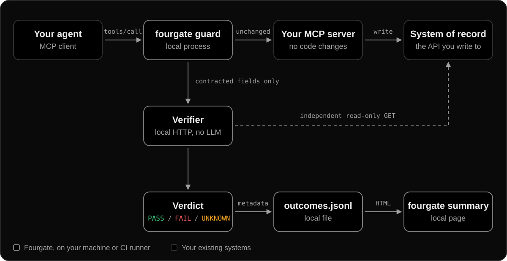

# Fourgate

**Independent outcome verification for consequential AI-agent actions.**

Fourgate catches MCP tools that say `success` when nothing actually happened.
After a contracted write reports success, it reads the system of record itself
and returns **PASS**, **FAIL**, or **UNKNOWN** — no LLM in the verdict path.

[](https://pypi.org/project/fourgate/0.4.0b1/)
[](https://pypi.org/project/fourgate/)
[](LICENSE)
[](https://github.com/hifzabuildsai/fourgate/actions/workflows/ci.yml)

**Status: limited beta (`0.4.0b1`).** Supported paths are **local
command-configured stdio** workflows only. Customer CI, complete Desktop UI
execution, and production reliability remain **unvalidated**. There is no
Fourgate hosted endpoint, no telemetry, and no remote MCP transport.

[Install](#install) · [What it checks](#what-it-checks) · [Product flow](#product-flow) · [Results so far](#results-so-far) · [Architecture](#system-architecture) · [OPERATOR.md](OPERATOR.md) · [PILOT.md](PILOT.md) · [SECURITY.md](SECURITY.md)

## Why this exists

An MCP tool can return a protocol-valid success (`isError` absent) while the
write never landed, landed wrong, or failed at the API. An agent that trusts
that result will continue as if the world changed.

Fourgate sits after the tool response for **explicitly contracted** tools and
runs a deterministic independent read-back:

- **Confirm the write** with a separate read credential and a GET to the
  provider API you configure — not by trusting the connector's prose.
- **Scan disposable accounts** with `fourgate scan` before you wrap live traffic.
- **Shadow by default** so the agent still sees the original bytes while you
  collect structural PASS / FAIL / UNKNOWN logs.
- **Enforce only on confirmed FAIL** — prepend an attributed verdict; PASS and
  UNKNOWN pass through. Verifier faults fail open. UNKNOWN is never PASS.
- **Stay on your machines** — local process, local logs, local reports. No
  Fourgate cloud.

## Install

Python 3.10–3.13, Linux or Windows. The limited-beta package is on PyPI today:

```bash
python -m pip install --pre "fourgate==0.4.0b1"
python -m fourgate --version
```

Expected output: `fourgate 0.4.0b1`. If `fourgate` is not on `PATH`,
`python -m fourgate` is equivalent.

Alternatives: the reviewed wheel on the
[`v0.4.0b1` GitHub pre-release](https://github.com/hifzabuildsai/fourgate/releases/tag/v0.4.0b1)
(check the published SHA-256),
`python -m pip install "git+https://github.com/hifzabuildsai/fourgate@v0.4.0b1"`,
or `python -m pip install .` from a clean checkout (needed for bundled fixtures).

Stable PyPI `0.3.0` remains installable without `--pre`; use `0.4.0b1` for the
current limited beta.

## What it checks

Independent read-back produces one of three outcomes. No LLM decides this.

| Verdict | Meaning |
| --- | --- |
| **PASS** | Authoritative read-back matched the contracted fields. Connector response unchanged. |
| **FAIL** | Read-back confirmed a missing or mismatched record. In **enforce**, Fourgate prepends `outcome_failed`; original content is preserved. In **shadow**, only the log changes. |
| **UNKNOWN** | Cannot confirm (timeout, auth, network, malformed verifier, missing selector, internal fault). Fails open; response unchanged. **Never counted as PASS.** Runtime verifier budget: **2000 ms**. |

Shadow mode is the default. Switch to enforce only for human-approved contracts
after shadow traffic looks clean.

## Product flow

```text
fourgate demo      # see it work: local, simulated, no keys, no network
fourgate init      # write scan, runtime and read-back configs for one write tool
fourgate doctor    # check the setup without side effects
fourgate scan      # contracted writes against a disposable test account
fourgate guard     # wrap the server at runtime (shadow first, then enforce)
fourgate summary   # turn outcomes.jsonl into a local HTML page
```

Operators: [`OPERATOR.md`](OPERATOR.md) (Windows PowerShell routine and
contracts). Pilots / security review: [`PILOT.md`](PILOT.md) (what runs where,
what is stored, where data goes). Second-person disposable scan (bash +
PowerShell): [`docs/external-disposable-scan.md`](docs/external-disposable-scan.md).
Measurement placeholders: [`docs/measurement-package.md`](docs/measurement-package.md).

## Results so far

Founder-run against **4 official vendor MCP servers** from 4 companies (local
stdio against the vendors' live APIs), using disposable test accounts or
deliberately invalid credentials so no real data could be changed
(snapshot **2026-10-01**).

| Check | Result |
| --- | --- |
| Servers where a write tool returned an API failure as a successful tool result (no `isError`) | **3 of 4**, each reproduced at least twice, reported upstream |
| Healthy write verified by independent read-back | 1 server: PASS, with FAIL and UNKNOWN controls behaving as specified |
| Runtime shadow calls from a real agent client | 2 of 2 PASS |
| Read-back-proven silent success (reported done, record missing or wrong) | 0 observed so far |

An agent reading a result without `isError` has no protocol-level signal that
the call failed. Fourgate reports these as `UNKNOWN / success_without_record_id`
rather than PASS. Vendors are not named here; details are under
[Field evidence](#field-evidence).

Later bounded GitHub Issue local + founder-owned hosted CI controls are
recorded separately; **customer CI validation remains pending.**

### Experimental agent setup and local MCP tools

Using Codex or Claude Code for setup: the experimental
[`fourgate-setup` project entries](docs/codex-setup.md) ([Claude guide](docs/claude-code-setup.md)) share one local stdio
workflow using the existing CLI. [Founder-reported Windows checks](docs/evidence/windows-codex-2026-10-23.md)
cover discovery, explicit activation and local scan controls; automatic activation
was not observed. Client shadow routing and external onboarding remain pending.
Installing Fourgate alone does not install the skill.

The experimental [local MCP validation tool](docs/local-mcp-validation.md) lets
an agent check one registered configuration using the same scanner loader.
It reports static readiness and NOT RUN; it cannot execute workflows or verify
an action. [Founder-reported Codex app-server checks](docs/evidence/windows-mcp-validation-2026-10-23.md)
cover discovery and one explicit call; complete Desktop UI protected execution
remains NOT RUN. The feature is included in `0.4.0b1`.

[Experimental MCP execution](docs/local-mcp-execution.md) adds `run_workflow`
and `get_run_report` only with a separate operator policy and prepared single-use
state. It reuses the scanner/verifier, bounds approved calls and distinguishes
saved reports from new execution. [Founder-reported Codex app-server checks](docs/evidence/windows-mcp-execution-2026-10-23.md)
cover local PASS, induced FAIL/UNKNOWN and saved-result replay at `c0e06f0e`;
the raw Windows artifacts were not independently reviewed here. Desktop UI
acceptance and customer workflows remain pending.

## System architecture

The runtime flow below uses a local stdio MCP server and the bundled HTTP
read-back verifier. Verification runs **after the tool response**, for
explicitly contracted tools; no LLM decides PASS / FAIL / UNKNOWN. The diagram
shows a configured `outcomes.jsonl` log.



The guard correlates requests with results and sends only contract-selected
fields to the verifier after a reported success. The verifier returns a typed
PASS or FAIL reply; the guard maps verifier faults and uncertainty to UNKNOWN,
applies the response mode, and records structural outcome metadata. Without
`--log`, outcome records go to stderr instead of the file shown above.

- **Shadow (default):** record the verdict and preserve the original response.
- **Enforce:** prepend an attributed verdict only on a confirmed FAIL,
  preserving the original content. PASS and UNKNOWN pass through unchanged.
- **Uncertainty:** verifier faults or timeouts produce UNKNOWN and fail open;
  each runtime verifier is capped at 2000 ms. UNKNOWN is never PASS.

Read credentials come from environment variables; list their names in
`verifier.secret_env` to withhold them from the wrapped MCP server. HTTP
read-back contacts the configured provider API; Fourgate has no hosted
endpoint or telemetry. Checks do not undo a write or retry it.

`fourgate scan` uses the same HTTP read-back implementation for contracted
writes against **authorized disposable accounts**, with local JSON/HTML
reports. See [`PILOT.md`](PILOT.md) for pilot setup and
[`SECURITY.md`](SECURITY.md) for data flow and report-sharing limits.

## Scan a disposable MCP test account (under five minutes)

After install, for the bundled **local fixture only**, set a disposable store
location and scan its deliberately broken issue creation. Bash:

```bash
export FOURGATE_DEMO_STORE="$(mktemp -d)/issues.json"
export FOURGATE_DEMO_MODE=broken
fourgate scan fixtures/contracts/scan_demo.json \
  --confirm-test-account disposable-demo --report-dir ./fourgate-output
```

PowerShell:

```powershell
$env:FOURGATE_DEMO_STORE = "$env:TEMP\fourgate-demo-issues.json"
$env:FOURGATE_DEMO_MODE = "broken"
fourgate scan fixtures/contracts/scan_demo.json --confirm-test-account disposable-demo --report-dir ./fourgate-output
```

The fixture paths need a source checkout (`python -m pip install .` from this
repository). The expected result is `FAIL / record_missing` (exit 1), with local
`fourgate-report.json` and self-contained `fourgate-report.html` in the chosen
directory. Set `FOURGATE_DEMO_MODE=healthy` and rerun with a fresh store path to
see PASS (exit 0). UNKNOWN is never counted as PASS (exit 1). Invalid scan
configuration exits 2. Reports include the exact contracted request, response,
read-back evidence and reproduction steps for a confirmed failure, after
best-effort secret redaction. Review locally before sharing.

Only explicitly named write tools and arguments in the contract are called.
The scanner supports stdio MCP servers and local command, generic HTTPS, or
GitHub Issue read-back. HTTP/GitHub verification makes GET requests to the
configured endpoint; no scan telemetry is sent to Fourgate. See
[`specs/scan-contract-v1.md`](specs/scan-contract-v1.md) and
[`SECURITY.md`](SECURITY.md). The GitHub contract remains a template: configure an authorized disposable
repository and separate credentials, and replace placeholder tools/selectors
after actual discovery. A bounded setup using the official local stdio GitHub
MCP server completed local read-back and hosted CI validation on our disposable
repository on 2026-10-11–12; see the
[dated evidence note](docs/evidence/github-validation-2026-10-12.md).

## Run in CI

The [GitHub Issue reference pack](examples/github-issue/README.md) provides one
reviewed-request update contract and a local-only PASS/FAIL/UNKNOWN
demonstration. It checks approved record number/title/body/state, documents
404/freshness/causality limits, and reuses the existing scanner and HTTP verifier.
The template is unconfigured; this is not new external workflow acceptance.

[`examples/ci/fourgate-scan.yml`](examples/ci/fourgate-scan.yml) is a
copy-paste GitHub Actions workflow for your own repository. It installs
Fourgate from a release tag, runs `fourgate scan` on manual dispatch, uploads
the JSON/HTML reports as a workflow artifact, and fails the job on any FAIL or
UNKNOWN (non-zero exit). Edit the marked values: contract path, the
`--confirm-test-account` label (must equal `server.test_account`), and the
environment variable names. The MCP server's write credential and the
read-back token come from two separate secrets, `FOURGATE_MCP_WRITE_TOKEN` and
`FOURGATE_READBACK_TOKEN`, mapped to separate environment variables.

Scans can perform real contracted writes: target a disposable test account
only. Credential prechecks can stop a scan before any write is sent. Workflow artifacts are readable by anyone with read access to the
repository, so use a private repository and review reports before sharing.
Fourgate's own CI runs the template's steps against the bundled demo fixture
(broken exits 1, healthy exits 0). On 2026-10-12, a manual-only adaptation ran
on GitHub-hosted Ubuntu against the official local stdio GitHub MCP server and
GitHub's live API in our private disposable repository: healthy PASS/exit 0/job
success; induced FAIL and pre-write UNKNOWN each exit 1/job failure. Cleanup and
reviewed report upload also ran after the negative exits.
[Evidence and the initial cleanup-harness correction](docs/evidence/github-validation-2026-10-12.md)
are recorded separately from the earlier vendor runs. **Customer CI validation
remains pending.**

## Outcome Guard MVP

The current pitch-ready slice protects explicitly contracted state-changing MCP tools. After a connector reports success, Fourgate extracts only the minimum contract-approved fields and runs a deterministic authoritative verifier. No LLM makes the runtime PASS/FAIL decision.

Three outcomes are possible:

- **PASS** — connector response is unchanged.
- **CONFIRMED FAIL** — in enforce mode, Fourgate prepends an attributed `outcome_failed` verdict before the connector's original content.
- **UNKNOWN** — verifier crash, timeout, malformed output, missing selector, or Fourgate internal fault fails open; connector response is unchanged.

Shadow mode is the default. It records structural verdict metadata without changing what the model receives.

### Run the proof

```bash
fourgate demo
```

One command, no API keys, no network: five real MCP sessions against a demo connector, the guarded ones through a real `fourgate guard` process, then a self-check and a local summary page (`./fourgate-demo/fourgate-demo-summary.html`). `--pace 2` slows it down for screen recording.

1. **Without Fourgate:** the broken connector returns `Created ISSUE-001`, but the system of record has 0 issues.
2. **Enforce, broken connector:** the agent receives `[FOURGATE] {"kind":"outcome_failed", ...}` (`record_missing`) first, with the original `Created ISSUE-001` preserved behind it.
3. **Enforce, healthy connector:** the issue exists, the response passes through unchanged, and the log records PASS.
4. **Shadow, broken connector:** the agent receives exactly what it got without Fourgate; the log still records FAIL `record_missing`.
5. **Enforce, system of record unreachable:** Fourgate cannot confirm either way, records UNKNOWN (never PASS), and does not block the call.

Simulated connector; a local file stands in for the system of record.

`python demo_outcome.py` remains for development from a source checkout.

### Scaffold a setup with fourgate init

```bash
fourgate init --tool create_issue --test-account disposable-demo   --id-path result.structuredContent.id   --readback-url 'https://api.example.com/issues/{record_id}'   --expect title=title --arg title=FOURGATE-SCAN-TEST   --token-env READBACK_TOKEN --missing-status 404   -- python your_server.py
```

`init` writes three files to `./fourgate-config` (`--dir` to change; it refuses to overwrite without `--force`): `readback.json` (the HTTP read-back), `runtime.json` (guard contracts using `fourgate.verify_http`) and `scan.json` (one scan case with the same read-back). It validates all three with the same loaders scan, guard and doctor use, and writes nothing if any check fails. Then it prints the next steps with your paths filled in: `fourgate doctor`, `fourgate scan`, `fourgate guard --mode shadow`, `fourgate summary`.

No flag takes a secret: credentials are named by environment variable (`--token-env`, `--username-env`), and the files contain only those names. `init` never reads their values, does not start the server, and does not contact any endpoint.

### Preflight with fourgate doctor

```bash
fourgate doctor --contracts path/to/contracts.json --log outcomes.jsonl -- python your_server.py
```

`doctor` takes the same setup arguments as `guard` and checks the setup before you wrap a real server: the contracts, each verifier (for the bundled `fourgate.verify_http`, its read-back config, URL rules, budget and failure reasons), that credential variables are set and withheld from the server, the outcome log location, and, when a server command follows `--`, that lifecycle discovery succeeds and every protected tool is advertised. It exits 0 when the setup is ready for shadow mode, 1 when it is not, and 2 on a usage error.

The default discovery lifecycle is legacy `2024-11-05`. For an explicitly selected
native server, add `--protocol-version 2026-07-28` to doctor before `--` and review
`server.protocol_version` in the scan contract. That mode uses `server/discover`
and per-request metadata; it does not fall back to initialize. Included in
`0.4.0b1` on PyPI. See [protocol limits](specs/scan-contract-v1.md).

It never sends `tools/call`, never runs a verifier, never makes a network request, and never creates or modifies a file. It therefore cannot confirm that the read credential is valid or read-only, or that the read-back endpoint is reachable. When a server command is given, the server is started only for `initialize` and `tools/list`; anything the server does on its own at start-up is outside Fourgate's control.

### Wrap a local stdio server

```bash
fourgate guard \
  --contracts path/to/contracts.json \
  --mode shadow \
  --server my-server \
  --log outcomes.jsonl \
  -- python your_server.py
```

Switch to `--mode enforce` only for human-approved contracts after shadow traffic is clean. `guard` validates the contracts at startup and exits 2 without starting the server if any are invalid; per-call verifier faults are still UNKNOWN and fail open. The startup summary goes to stderr, so stdout carries only MCP traffic. `python wrap/wrap.py` with its existing flags remains supported for existing setups.

For a hosted connector, the verifier can be the scan's own HTTP read-back:
`python -m fourgate.verify_http readback.json` takes the extracted fields on
stdin and runs the same bounded GET as `fourgate scan`. Any uncertainty exits
nonzero and is recorded as UNKNOWN. `verifier.secret_env` names the read
credential's environment variables; `fourgate guard` removes them from the wrapped
server's environment while the verifier still receives them:

```json
{
  "contract_version": 1,
  "tools": {
    "create_issue": {
      "extract": {
        "issue_id": {"source": "result", "path": "result.structuredContent.issue_id"},
        "title": {"source": "arguments", "path": "title"}
      },
      "verifier": {
        "command": ["{python}", "-m", "fourgate.verify_http", "readback.json"],
        "cwd": ".",
        "timeout_ms": 2000,
        "secret_env": ["READBACK_TOKEN"]
      },
      "allowed_failure_reasons": ["field_mismatch"],
      "recovery": "stop"
    }
  }
}
```

### See the results

```bash
fourgate summary outcomes.jsonl --out fourgate-summary.html
```

Turns one or more `outcomes.jsonl` files into a single local HTML page: total
protected calls, PASS / FAIL / UNKNOWN by tool and by day, what each reason
means, and the latency Fourgate added (median and p95). The page has no
JavaScript and makes no network requests. Like the log, it contains structure
only: no arguments, record values, response bodies or credentials. It also
prints a one-line text summary (`--json` for machine-readable output).

`readback.json` is a scan contract `readback` object with `timeout_ms` of at
most 1500. The read token is sent as `Authorization: Bearer` unless
`readback.auth` selects a custom header (`{"scheme": "header", "header":
"X-Api-Key"}`) or Basic auth; `readback.headers` adds fixed, non-secret headers
such as an API version. List every read credential variable (`token_env`, and
`auth.username_env` if used) in `verifier.secret_env`. Details:
[`OPERATOR.md` → 3c](OPERATOR.md#3c-find-the-read-back-get-endpoint). Step-by-step setup and the verifier dry run are in
[`HANDOFF.md` → Shadow mode with a real connector](HANDOFF.md#shadow-mode-with-a-real-connector).

See [`specs/outcome-guard-mvp.md`](specs/outcome-guard-mvp.md) for the contract and failure semantics.

## Existing components

### Preflight CLI

`checker/preflight.py` starts a Python MCP server over stdio, speaks raw JSON-RPC, detects stdout pollution, and exercises a limited set of schema/argument edge cases. Keep it free/low-cost infrastructure; it is not a replacement for MCP Inspector or conformance tooling.

### Runtime wrap

`wrap/wrap.py` is the on-path stdio proxy. It already correlates `tools/call` requests/results by JSON-RPC id, supports byte-identical pass-through, a bounded fail-open legacy classifier path, an attributed in-band verdict, and shape-only observation.

The existing `silent_empty` behavior remains deliberately narrow. Fourgate does **not** flag `{"issues":[]}`, `No matches found`, or explicit empty structured data merely because it is empty. Empty data is wrong only when an approved contract/postcondition proves it.

## Field evidence

The original field run observed 24 real `tools/call` results and zero `silent_empty` events. Four observed failures happened before `tools/call` at spawn/connect/discovery/configuration. That weakens the original empty-payload wedge; it does not validate Outcome Guard on its own.

### Hosted scan validation (2026-09-30)

Operator-reported validation on a disposable account: a real hosted MCP write
returned an ID, and an independent HTTPS read-back with a separate credential
produced `PASS / postcondition_satisfied`. An intentionally mismatched
postcondition produced `FAIL / field_mismatch` with authoritative read-back
evidence. A manual search of the generated reports found neither tested API
credential. No naturally occurring false-success incident was observed. This
single integration does not establish production reliability.

### Runtime shadow run (2026-10-01)

Operator-reported: a real agent client made two protected send calls through
`wrap.py` in shadow mode against the same hosted email-sending MCP server on a
disposable account, verified by `fourgate.verify_http` with `secret_env`
withholding the read-back key from the connector. `outcomes.jsonl` recorded
`pass / postcondition_satisfied` for both. Two calls is a smoke test, not
production traffic.

### GitHub validation (2026-10-11–12)

Reviewed local operator evidence reports two healthy issue/title read-backs and
one real runtime shadow write as PASS, with same-call response preservation.
Separately checked hosted Actions results show PASS/0/success and induced
FAIL/1/failure and UNKNOWN/1/failure; the hosted UNKNOWN stopped before a write.
The initial hosted cleanup harness failed and was corrected before the final
runs. See the [dated, sanitized evidence note](docs/evidence/github-validation-2026-10-12.md)
for provenance, private access requirements and limits. No natural silent-success
finding was established; customer CI validation remains pending.

### Errors returned as success (2026-10-01 snapshot)

Operator scans of three official company MCP servers (hosting, payments, work
management), using deliberately invalid credentials so nothing could be
created, found write tools returning API failures as successful tool results
with no `isError`. Fourgate reports these as `UNKNOWN /
success_without_record_id`. Each was reproduced at least twice and reported
upstream. These are error-reporting bugs: no read-back-proven silent success
(a write reported as done whose record is missing or wrong) has been observed
yet.

## Current limitations

- **Limited beta `0.4.0b1`:** local command-configured **stdio** only; customer CI, complete Desktop UI execution, and production reliability remain unvalidated.
- Outcome contracts are hand-authored and human-approved; generation is not implemented.
- Runtime verifiers are local commands. The bundled one, `fourgate.verify_http`, is a generic HTTP GET read-back; the read credential can be sent as a Bearer token, a custom header, or Basic auth; there are no database adapters.
- Outcome verification adds read-back latency on the protected call. The runtime caps each verifier at **2000 ms** and fails open (**UNKNOWN**) on uncertainty. UNKNOWN is never PASS. `verify_http` measured 1.2–1.6 s per call on a Windows laptop, and a first cold call exceeded its budget, so headroom is small on slow networks.
- No remote MCP transport, Fourgate hosted endpoint, telemetry, dashboard, alerting product, gateway, retry engine, or automatic compensation.
- The older `checker/preflight.py` remains a separate legacy diagnostic. Scanner/doctor have explicit legacy and `2026-07-28` modes tested with local fixtures; that is not universal compatibility. Legacy SDK tests still use the dev-only `mcp==1.9.4` pin.

## Tests

```bash
python -m pip install -e ".[dev]"
python -m pytest -q
python wrap/wrap.py --selfcheck
```

The `dev` extra installs `pytest` and the `mcp==1.9.4` package that the
preflight tests need.

## License

MIT — see [LICENSE](LICENSE).
